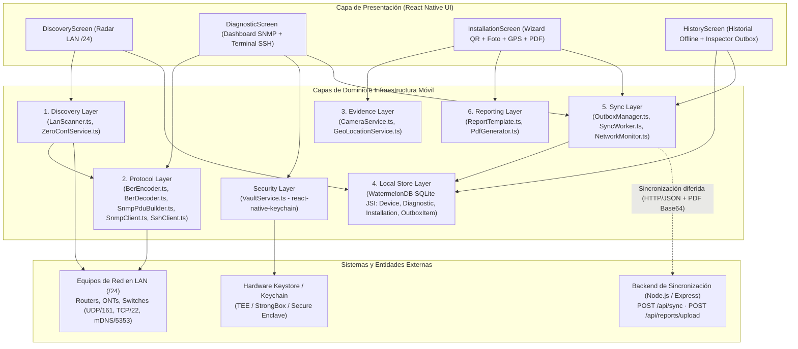

# Documentación Técnica de Arquitectura e Ingeniería de Protocolos
## Proyecto: Network Diagnostics Suite
**Cátedra**: Desarrollo de Aplicaciones Móviles (2026) — Licenciatura en Sistemas de Información (FCyT - UADER)  
**Paradigma**: React Native Bare Workflow · Sockets Binarios UDP/TCP Nativos · Offline-First Transactional Outbox · Zero-Trust Security

---

## 1. Arquitectura en Capas y Mapeo de Responsabilidades

La aplicación implementa una arquitectura estricta de **6 capas de dominio desacopladas**, consumidas por una capa de presentación reactiva e integradas con tres sistemas externos: la red local de equipos de telecomunicaciones (LAN), el almacén criptográfico de hardware del sistema operativo (Android Keystore / iOS Keychain) y el servidor de sincronización diferida (`backend-stub`).

### 1.1 Diagrama de Arquitectura del Sistema



### 1.2 Mapeo Formal de Responsabilidades por Capa

| Capa Arquitectónica | Módulos Principales (`src/layers/...`) | Responsabilidad Técnica | Tecnologías / Módulos Nativos |
| :--- | :--- | :--- | :--- |
| **1. Discovery Layer** | `discovery/LanScanner.ts`<br>`discovery/ZeroConfService.ts` | Barrido activo de subred `/24` mediante sondas unicast UDP/161 y handshakes TCP/22 y TCP/80, lectura de tabla ARP del kernel (`/proc/net/arp`), identificación de fabricantes por prefijo OUI IEEE y resolución multicast mDNS/Bonjour (`224.0.0.251:5353`). | `react-native-udp`<br>`react-native-tcp-socket`<br>`react-native-zeroconf`<br>`@react-native-community/netinfo` |
| **2. Protocol Layer** | `protocol/snmp/BerEncoder.ts`<br>`protocol/snmp/BerDecoder.ts`<br>`protocol/snmp/SnmpPduBuilder.ts`<br>`protocol/snmp/SnmpClient.ts`<br>`protocol/ssh/SshClient.ts`<br>`protocol/ssh/CommandProfiles.ts` | Codificación y decodificación manual de tramas binarias ASN.1/BER sin dependencias externas; transporte de datagramas SNMP v1/v2c sobre sockets UDP/161 con *buffer pooling* y control de *timeout* vía `Promise.race()`; ejecución de sesiones SSHv2 con perfiles de diagnóstico por fabricante (Cisco, MikroTik, Huawei, Linux/OpenWrt). | `react-native-udp`<br>`react-native-ssh-sftp`<br>`buffer` |
| **3. Evidence Layer** | `evidence/CameraService.ts`<br>`evidence/GeoLocationService.ts` | Escaneo de códigos QR, Code-128 y EAN-13 en etiquetas de chasis de equipos; captura fotográfica de evidencia en campo; georreferenciación satelital GPS de alta precisión con estampa de tiempo UTC ISO-8601. | `react-native-vision-camera`<br>`react-native-geolocation-service`<br>`react-native-fs` |
| **4. Local Store Layer** | `store/schema.ts`<br>`store/database.ts`<br>`store/models/{Device,Diagnostic,Installation,OutboxItem}.ts` | Persistencia relacional reactiva 100% *offline-first* sobre motor SQLite nativo con enlace JSI. Almacena inventario de nodos, instantáneas SNMP/SSH, órdenes de instalación y la cola transaccional de salida (`outbox_queue`). | `@nozbe/watermelondb` |
| **5. Sync Layer** | `sync/OutboxManager.ts`<br>`sync/SyncWorker.ts`<br>`sync/NetworkMonitor.ts` | Escritura atómica en lote (`database.batch`) de entidad de negocio + evento de salida; monitoreo reactivo de enlace e Internet; drenaje secuencial FIFO por lotes con reintentos automáticos y *backoff* exponencial ($2^n \times 1000\text{ ms}$). | `@react-native-community/netinfo`<br>`@nozbe/watermelondb` |
| **6. Reporting Layer** | `reporting/ReportTemplate.ts`<br>`reporting/PdfGenerator.ts` | Maquetación de certificado técnico corporativo en HTML5/CSS3 con telemetría MIB-II, coordenadas GPS y fotografía embebida en Base64; compilación nativa a documento PDF A4 persistido en el sistema de archivos local. | `react-native-html-to-pdf`<br>`react-native-fs` |
| **Security Layer** | `security/VaultService.ts` | Resguardo criptográfico Zero-Trust de credenciales SSH (contraseñas y llaves privadas) y *Community Strings* SNMP en hardware seguro del dispositivo. | `react-native-keychain` |

---

## 2. Ingeniería de Protocolo: Subconjunto SNMP v1/v2c Binario (ASN.1 / BER sobre UDP/161)

Debido a que el ecosistema JavaScript/React Native carece de motores SNMP nativos listos para producción sobre sockets móviles crudos, se diseñó e implementó desde cero un codificador/decodificador binario **ASN.1 Basic Encoding Rules (BER, ITU-T X.690)** acoplado a `react-native-udp`.

### 2.1 Estructura de la Trama SNMP y Primitivas TLV (Tag-Length-Value)

Cada elemento dentro de un mensaje SNMP (RFC 1157 para SNMPv1 y RFC 1905 para SNMPv2c) se serializa como una tupla **TLV** (*Tag - Length - Value*):

```text
+-------------------+----------------------------+-----------------------------------+
|   Tag (1 Octeto)  |  Length (1 a 5 Octetos)    |       Value (N Octetos)           |
+-------------------+----------------------------+-----------------------------------+
| Clase | P/C | Núm | Forma corta: 0xxxxxxx      | Contenido primitivo o secuencia   |
| (2b)  | (1b)| (5b)| Forma larga: 1xxxxxxx + L  | anidada de sub-elementos TLV      |
+-------------------+----------------------------+-----------------------------------+
```

#### Tipos ASN.1 / SMI Soportados

| Tag Hex | Nombre del Tipo ASN.1 / SMI | Clase / Construcción | Uso en Network Diagnostics Suite |
| :---: | :--- | :--- | :--- |
| `0x02` | `INTEGER` | Universal · Primitivo | `version` (`0` = v1, `1` = v2c), `request-id`, `error-status`, `error-index`. Codificado en complemento a dos de longitud mínima. |
| `0x04` | `OCTET STRING` | Universal · Primitivo | `community` (ej. `"public"`), `sysDescr.0`, `sysName.0` o direcciones físicas MAC. |
| `0x05` | `NULL` | Universal · Primitivo | Valor marcador (`0x05 0x00`) dentro de cada `VarBind` en una consulta `GetRequest-PDU`. |
| `0x06` | `OBJECT IDENTIFIER` | Universal · Primitivo | Identificadores jerárquicos MIB-II comprimidos mediante regla `40*X + Y` y VLQ en base 128. |
| `0x30` | `SEQUENCE` | Universal · Construido | Contenedor del mensaje SNMP general, de `VarBindList` y de cada par `VarBind`. |
| `0x41` | `Counter32` | Aplicación 1 · Primitivo | Entero sin signo de 32 bits para tráfico acumulado en `ifInOctets.1` e `ifOutOctets.1`. |
| `0x42` | `Gauge32` | Aplicación 2 · Primitivo | Entero sin signo de 32 bits para métricas de capacidad o velocidad de interfaz. |
| `0x43` | `TimeTicks` | Aplicación 3 · Primitivo | Entero sin signo de 32 bits en centésimas de segundo ($\frac{1}{100}\text{ s}$) para `sysUpTime.0`. |
| `0xA0` | `GetRequest-PDU` | Contexto `[0]` · Construido | Encabezado de solicitud de lectura enviada desde el móvil al puerto UDP 161 del agente. |
| `0xA2` | `GetResponse-PDU` | Contexto `[2]` · Construido | Encabezado de respuesta devuelta por el agente SNMP hacia el puerto UDP efímero del móvil. |

### 2.2 Reglas de Codificación Binaria Implementadas (`BerEncoder.ts` y `BerDecoder.ts`)

1. **Codificación de Longitud Definida (Definite Length)**:
   - **Forma corta** ($0 \le L \le 127$): Un único octeto con el bit 7 en `0` y los bits 6..0 representando $L$.
   - **Forma larga** ($L \ge 128$): El primer octeto tiene el bit 7 en `1` (`0x80 | k`), donde $k$ indica la cantidad de octetos subsiguientes en *big-endian* que expresan la longitud total del campo `Value`.
2. **Codificación de `INTEGER` (`0x02`) y Enteros Sin Signo de Aplicación (`0x41`, `0x43`)**:
   - En ASN.1 BER, los enteros se codifican en complemento a dos *big-endian*. Si un entero positivo (o un `Counter32` mayor o igual a $2^{31}$, como `3849201920`) tiene el bit más significativo del primer octeto en `1` (`byte[0] & 0x80 !== 0`), el codificador antepone un octeto `0x00` para preservar el signo positivo.
3. **Codificación VLQ Base-128 de `OBJECT IDENTIFIER` (`0x06`)**:
   - Los dos primeros arcos del OID ($X.Y$, por ejemplo `1.3` en ISO-ORG) se fusionan en un único sub-identificador según la fórmula:
     $$\text{SubID}_0 = 40 \times X + Y = 40 \times 1 + 3 = 43 \text{ (0x2B)}$$
   - Cada sub-identificador subsiguiente se divide en grupos de 7 bits (*septets*) en orden *big-endian*. Todos los octetos intermedios llevan el bit 7 en `1` (`0x80`), mientras que el último octeto del sub-identificador lleva el bit 7 en `0`.
   - Ejemplo para `sysDescr.0` (`1.3.6.1.2.1.1.1.0`):
     `06 08 2B 06 01 02 01 01 01 00`

### 2.3 Diagrama de Trama Binaria de un `GetRequest-PDU` SNMPv2c

```text
30 29                                      ; SEQUENCE (Longitud total = 41 bytes)
 ├─ 02 01 01                               ;   version: INTEGER = 1 (SNMPv2c)
 ├─ 04 06 70 75 62 6C 69 63                ;   community: OCTET STRING = "public"
 └─ A0 1C                                  ;   GetRequest-PDU (Longitud = 28 bytes)
     ├─ 02 04 08 D6 B8 32                  ;     request-id: INTEGER = 148291042
     ├─ 02 01 00                           ;     error-status: INTEGER = 0 (noError)
     ├─ 02 01 00                           ;     error-index: INTEGER = 0
     └─ 30 0E                              ;     variable-bindings: SEQUENCE (14 bytes)
         └─ 30 0C                          ;       VarBind #1: SEQUENCE (12 bytes)
             ├─ 06 08 2B 06 01 02 01 01 01 00 ;    name: OID 1.3.6.1.2.1.1.1.0 (sysDescr.0)
             └─ 05 00                      ;       value: NULL
```

### 2.4 Alcance y Limitaciones de Seguridad del Protocolo SNMP v1/v2c

Tal como se establece en el diseño arquitectónico del sistema, el cliente implementa SNMPv1/v2c basado en *Community Strings* para garantizar compatibilidad universal con ONTs, antenas y switches de acceso legados:
- **Limitación inherente del protocolo v1/v2c**: La cadena de comunidad viaja codificada en BER (`OCTET STRING`) sin cifrado de capa de transporte sobre UDP/161.
- **Mitigaciones aplicadas en la suite**:
  1. Uso exclusivo de operaciones de solo lectura (`GetRequest-PDU` `0xA0`); no se emiten tramas `SetRequest-PDU` (`0xA3`).
  2. Las *Community Strings* personalizadas por nodo nunca se almacenan en SQLite ni en texto plano; se resguardan cifradas en el **Keystore/Keychain de hardware** mediante `VaultService`.
  3. Las operaciones de administración activa o diagnóstico profundo se delegan al canal cifrado **SSHv2 (TCP/22)**.

---

## 3. Almacenamiento Criptográfico Zero-Trust (Keystore / Keychain)

En cumplimiento estricto de **OWASP Mobile Top 10 (M1: Improper Credential Usage / M9: Insecure Data Storage)**, el módulo [`VaultService.ts`](./src/layers/security/VaultService.ts) prohíbe la persistencia de secretos en `AsyncStorage`, WatermelonDB/SQLite o variables de entorno empaquetadas en el bundle JS.

### 3.1 Arquitectura Criptográfica en `VaultService`

1. **Aislamiento por Dispositivo Objetivo**: Cada par de credenciales (`sshUsername`, `sshPassword`, `sshPrivateKey`, `snmpCommunity`) se indexa bajo un identificador de servicio dedicado:
   `com.fcyt.networkdiagnosticssuite.vault.<sanitized_ip>`.
2. **Android Keystore System (Hardware-Backed TEE / StrongBox)**:
   - Se invoca `Keychain.setGenericPassword` con `storage: Keychain.STORAGE_TYPE.AES` y `securityLevel: Keychain.SECURITY_LEVEL.SECURE_HARDWARE`.
   - Las llaves maestras AES-256-GCM residen dentro del *Trusted Execution Environment* (TEE) o *StrongBox Keymaster* del SoC y no son extraíbles incluso ante compromiso de root en el sistema de archivos de la aplicación.
   - En `AndroidManifest.xml` se establece explícitamente `android:allowBackup="false"` y `android:fullBackupContent="false"` para impedir la extracción de datos vía `adb backup`.
3. **iOS Keychain Services (Secure Enclave)**:
   - Se aplica la política de protección `Keychain.ACCESSIBLE.WHEN_UNLOCKED_THIS_DEVICE_ONLY` (`kSecAttrAccessibleWhenUnlockedThisDeviceOnly`).
   - Los registros quedan cifrados por el *Secure Enclave* y excluidos de respaldos de iCloud o iTunes, impidiendo su restauración en otro dispositivo físico.

---

## 4. Ciclo de Sincronización Diferida (Transactional Outbox Pattern)

Los técnicos de telecomunicaciones operan frecuentemente en azoteas, sótanos técnicos, nodos rurales o gabinetes blindados sin cobertura LTE/5G ni salida a Internet. Para garantizar cero pérdida de datos, la aplicación implementa el patrón **Transactional Outbox** sobre WatermelonDB.

### 4.1 Diagrama de Secuencia del Flujo Offline-First y Outbox

```mermaid
sequenceDiagram
    autonumber
    actor Tech as Técnico de Campo
    participant UI as InstallationScreen / DiagnosticScreen
    participant PDF as PdfGenerator (HTML-to-PDF)
    participant OB as OutboxManager
    participant DB as WatermelonDB (SQLite JSI)
    participant NET as NetworkMonitor (NetInfo)
    participant WK as SyncWorker
    participant API as Backend Stub (Express)

    Tech->>UI: Completa orden (QR + Foto + GPS + Notas)
    UI->>PDF: generateInstallationPdf(orderInput)
    PDF-->>UI: PDF persistido en Documents/installation_RPT.pdf
    UI->>OB: recordInstallationAndEnqueue(order, pdfUri, reportId)
    
    rect rgb(30, 41, 59)
        Note over OB,DB: Transacción Atómica SQLite (database.batch)
        OB->>DB: INSERT INTO installations (status = 'PENDING_SYNC')
        OB->>DB: INSERT INTO outbox_queue (event_type = 'SYNC_INSTALLATION', status = 'PENDING', attempts = 0)
    end
    DB-->>UI: Confirmación local inmediata (Operación 100% Offline exitosa)

    Note over NET,WK: El técnico recupera cobertura 4G/5G o Wi-Fi con salida WAN
    NET->>WK: Evento NetInfo (isConnected && isInternetReachable)
    WK->>DB: fetchNextBatch(status IN ['PENDING','FAILED'], next_retry_at <= now)
    DB-->>WK: Lote FIFO de OutboxItems
    WK->>DB: markInFlight(batch) -> status = 'IN_FLIGHT'

    WK->>API: GET /api/health
    alt Enlace y Servidor Operativos (HTTP 200)
        API-->>WK: { status: "ok" }
        WK->>API: POST /api/sync (JSON Batch)
        API-->>WK: { status: "ok", processed_ids: [...] }
        WK->>API: POST /api/reports/upload (PDF Base64)
        API-->>WK: HTTP 201 Created (PDF Archivado)
        WK->>DB: markSynced(batch) -> outbox.status = 'SYNCED', installation.status = 'SYNCED'
    else Fallo de Red o Timeout HTTP
        API--xWK: Error de Transporte / HTTP 5xx
        Note over WK,DB: Cálculo de Backoff Exponencial: delay = 2^(attempts) * 1000 ms
        WK->>DB: markFailedWithBackoff(attempts + 1, next_retry_at = now + delay)
        WK->>WK: Reprogramar timer para próximo intento
    end
```



### 4.2 Máquina de Estados y Fórmula de Backoff Exponencial

Cada registro en la tabla `outbox_queue` transita por los estados:
- `PENDING`: Encolado y listo para ser despachado cuando `Date.now() >= next_retry_at`.
- `IN_FLIGHT`: Actualmente en tránsito HTTP hacia `/api/sync`.
- `SYNCED`: Confirmado por el servidor mediante su inclusión en `processed_ids` y con su PDF archivado en `/api/reports/upload`.
- `FAILED`: Alcanzó el umbral máximo de reintentos (`MAX_RETRY_ATTEMPTS = 6`) o aguarda intervención manual desde la pantalla de historial.

Ante un fallo transitorio en el intento $n \in \{1, 2, \dots, 6\}$, el tiempo de espera antes del siguiente reintento se calcula mediante:

$$T_{\text{backoff}}(n) = 2^n \times 1000\text{ ms}$$

| Intento ($n$) | Espera Calculada ($T_{\text{backoff}}$) | Acumulado Aproximado |
| :---: | :---: | :---: |
| 1 | $2\text{ s}$ (`2000 ms`) | $2\text{ s}$ |
| 2 | $4\text{ s}$ (`4000 ms`) | $6\text{ s}$ |
| 3 | $8\text{ s}$ (`8000 ms`) | $14\text{ s}$ |
| 4 | $16\text{ s}$ (`16000 ms`) | $30\text{ s}$ |
| 5 | $32\text{ s}$ (`32000 ms`) | $62\text{ s}$ |
| 6 | $64\text{ s}$ (`64000 ms`) → Estado `FAILED` | $126\text{ s}$ |

---

## 5. Instrucciones de Ejecución y Guía para la Demo Evaluativa

### 5.1 Requisitos Previos del Entorno
- **Node.js** `>= 18.x` (recomendado `v20` o `v22`).
- **Android Studio / Android SDK** (Platform 34, NDK `26.1.10909125`) y un dispositivo físico Android conectado vía USB Depuración en la misma red Wi-Fi que los equipos a diagnosticar (o emulador Android para pruebas contra el backend).
- **Importante**: No utilizar Expo Go; el proyecto emplea **React Native Bare Workflow** con vinculación nativa (`autolinking`) de sockets C++/JNI (`react-native-udp`, `react-native-tcp-socket`, `react-native-ssh-sftp`, `@nozbe/watermelondb`).

### 5.2 Ejecución de Pruebas Unitarias del Motor Binario ASN.1/BER y SNMP

Para verificar en cualquier estación de trabajo la codificación/decodificación binaria de tramas SNMP v1/v2c, OIDs VLQ en base 128 y plantillas de reporte HTML sin requerir emulador:

```bash
npm test
```

### 5.3 Inicio del Backend Stub de Sincronización (`backend-stub`)

1. Instalar dependencias e iniciar el servidor en el puerto `4600`:
   ```bash
   cd backend-stub
   npm install
   npm start
   ```
2. Verificar estado del servicio:
   ```bash
   curl http://localhost:4600/api/health
   ```
   - Por cable USB Depuración, reenviar el puerto con `adb reverse tcp:4600 tcp:4600` (la app apunta por defecto a `http://localhost:4600`).
   - En un teléfono físico conectado solo por Wi-Fi, ingresar en la pestaña **Offline Store (HistoryScreen)** la IP LAN de la PC donde corre el backend (ej. `http://192.168.1.50:4600`) y presionar **Set URL**.

### 5.4 Compilación e Instalación de la App Móvil (Android APK)

1. Instalar dependencias en la raíz del proyecto:
   ```bash
   npm install
   ```
2. Compilar e instalar la variante de prueba en el dispositivo o emulador conectado:
   ```bash
   npm run android
   ```
3. Para generar el archivo APK instalable de entrega:
   ```bash
   cd android
   ./gradlew assembleDebug
   ```
   El APK resultante se ubicará en `android/app/build/outputs/apk/debug/app-debug.apk`.

### 5.5 Guion Paso a Paso para la Demo Evaluativa

1. **Descubrimiento LAN (RF-01)**:
   - Abrir la pestaña **LAN Radar (`DiscoveryScreen`)**, verificar el prefijo `/24` detectado (ej. `192.168.1`) y presionar **Start Active LAN & mDNS Sweep**.
   - Observar los dispositivos descubiertos con su IP, MAC, Hostname/mDNS, latencia en milisegundos y estado de puertos `SNMP UDP/161` y `SSH TCP/22`.
2. **Almacenamiento Seguro y Diagnóstico SNMP/SSH (RF-02, RF-03)**:
   - Seleccionar **SNMP & SSH Diagnostics** sobre un nodo descubierto.
   - Configurar la *Community String* y las credenciales SSH, y presionar **Save Credentials to Hardware Keystore / Keychain** para persistirlas en el almacén seguro del sistema operativo.
   - Presionar **Poll MIB-II OIDs** para emitir un `GetRequest-PDU` binario sobre `UDP/161` y visualizar `sysName.0`, `sysDescr.0`, `sysUpTime.0`, `ifInOctets.1` e `ifOutOctets.1`.
   - Seleccionar el perfil del fabricante (`CISCO`, `MIKROTIK`, `HUAWEI` o `LINUX`) y ejecutar un comando diagnóstico SSH o la suite completa en la terminal embebida.
3. **Modo Offline, Captura de Evidencia y Reporte PDF (RF-04, RF-05, RF-06, RF-07)**:
   - Desactivar los datos móviles / acceso a Internet del dispositivo (o apagar temporalmente el `backend-stub`) para demostrar operación 100% *offline*.
   - Pasar a la pestaña **Install & PDF (`InstallationScreen`)**.
   - Presionar **Scan QR / Barcode** para leer el código del equipo con la cámara, **Acquire High-Precision GPS** para fijar latitud/longitud con precisión métrica y timestamp UTC, y **Capture Evidence Photo** para tomar la fotografía de la instalación.
   - Presionar **Generate PDF Report & Enqueue in Offline Outbox**. Se generará el PDF corporativo localmente y se insertará la orden en `outbox_queue` con estado `PENDING`.
4. **Sincronización Diferida Automática y Consulta de Historial (RF-07, RF-08)**:
   - En la pestaña **Offline Store (`HistoryScreen`)**, verificar que el reporte, el diagnóstico y el ítem en la cola Outbox son consultables sin conexión.
   - Restablecer la conectividad (o iniciar nuevamente el `backend-stub`). `NetworkMonitor` despertará automáticamente a `SyncWorker` (o presionar **Flush Pending Outbox Queue Now**), cambiando los registros a `SYNCED` y archivando tanto el lote JSON en `backend-stub/src/storage/sync/` como el documento PDF en `backend-stub/src/storage/reports/`.

