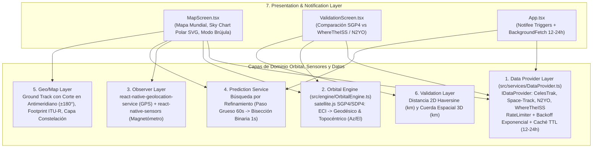

# Documentación Técnica de Mecánica Orbital, Fuentes de Datos y Validación Cruzada
## Proyecto: TP N° 7 — Satellite Tracker
**Cátedra**: Programación Móviles (2026) — Licenciatura en Sistemas de Información (FCyT - UADER)  
**Paradigma**: React Native · Propagación Analítica SGP4/SDP4 Local (`satellite.js`) · Caché Resiliente con Rate Limiting y Fallback · Validación Cruzada Geodésica y Espacial

---

## 1. Arquitectura en 7 Capas y Mapeo de Responsabilidades

| Capa Arquitectónica | Módulo Principal | Responsabilidad Técnica | Tecnologías |
| :--- | :--- | :--- | :--- |
| **1. Data Provider Layer** | `src/services/DataProvider.ts` | Interfaz unificada `IDataProvider` (`getCatalog`, `getOrbitalData`, `getValidationPosition`), *rate limiter* por ventana deslizante, cola de reintentos con *backoff* exponencial, caché `AsyncStorage` con TTL (12–24 h) y *failover* automático. | `fetch`, `AsyncStorage`, `react-native-keychain` |
| **2. Orbital Engine** | `src/engine/OrbitalEngine.ts` | Propagación local SGP4/SDP4 de elementos medios (TLE de 2 líneas y OMM/JSON con soporte para IDs NORAD de 6 dígitos), conversión de vectores $\mathbf{r}_{\text{ECI}}, \mathbf{v}_{\text{ECI}}$ a coordenadas geodésicas WGS-84 y ángulos de vista topocéntricos. | `satellite.js` |
| **3. Observer Layer** | `src/screens/MapScreen.tsx` | Obtención de coordenadas geodésicas de la estación terrena del usuario y lectura del vector de campo magnético para orientación asistida hacia el azimut del satélite. | `react-native-geolocation-service`, `react-native-sensors` |
| **4. Prediction Service** | `src/engine/OrbitalEngine.ts` | Detección eficiente de ventanas de visibilidad (`AOS`, `Max Elevation`, `LOS`) mediante muestreo grueso ($60\text{ s}$) y refinamiento por bisección binaria ($1\text{ s}$). | TypeScript |
| **5. Geo/Map Layer** | `src/screens/MapScreen.tsx` | Renderizado del marcador subsatelital animado cada 1–2 s localmente, segmentación de la polilínea del *ground track* al cruzar el antimeridiano ($\pm 180^\circ$), cálculo del *footprint* según elevación mínima y capa de constelación Starlink con límite de objetos. | `react-native-maps`, `react-native-svg` |
| **6. Validation Layer** | `src/screens/ValidationScreen.tsx` | Evaluación de exactitud en el mismo instante UTC contra *Where the ISS at?* (`NORAD 25544`) y *N2YO* (cualquier satélite), reportando error superficial 2D (Haversine) y error espacial 3D en kilómetros. | TypeScript |
| **7. Notification Layer** | `App.tsx` | Programación de alertas `TimestampTrigger` $N$ minutos antes del `AOS` y tarea periódica en segundo plano para refrescar efemérides vencidas. | `@notifee/react-native`, `react-native-background-fetch` |

---

## 2. Modelo de Propagación Orbital SGP4/SDP4, Supuestos y Limitaciones

### 2.1 Marco Matemático y Conversiones de Coordenadas
1. **Propagación en Marco Inercial TEME (`ECI`)**:
   A partir del registro orbital (`SatRec`) inicializado desde un bloque **OMM/JSON** o **TLE**, la función `satellite.propagate(satrec, date)` resuelve las ecuaciones seculares y periódicas de **SGP4** (para órbitas cercanas con período $T < 225\text{ min}$) o **SDP4** (para órbitas de espacio profundo $T \ge 225\text{ min}$, incluyendo resonancias lunisolares de $12\text{ h}$ en MEO/GPS y $24\text{ h}$ en GEO), obteniendo posición $\mathbf{r}_{\text{ECI}} = (x, y, z)\text{ km}$ y velocidad $\mathbf{v}_{\text{ECI}} = (\dot{x}, \dot{y}, \dot{z})\text{ km/s}$.
2. **Conversión a Punto Subsatelital Geodésico (`WGS-84`)**:
   Calculando el Tiempo Sidéreo Medio de Greenwich $\theta_{\text{GMST}}$ (`satellite.gstime(date)`), se rota el vector inercial al elipsoide terrestre mediante `eciToGeodetic`, obteniendo latitud geodésica $\phi \in [-90^\circ, 90^\circ]$, longitud $\lambda \in [-180^\circ, 180^\circ]$ y altitud ortométrica $h\text{ (km)}$ sobre el elipsoide.
3. **Conversión a Coordenadas Topocéntricas del Observador (`Azimut / Elevación`)**:
   Con la posición del usuario $(\phi_{\text{obs}}, \lambda_{\text{obs}}, h_{\text{obs}})$, se transforma $\mathbf{r}_{\text{ECI}} \to \mathbf{r}_{\text{ECF}}$ (`eciToEcf`) y luego al sistema horizonte local Sur-Este-Cenit (`ecfToLookAngles`), determinando:
   - **Azimut** $\text{Az} \in [0^\circ, 360^\circ)$ medido desde el Norte geográfico en sentido horario.
   - **Elevación** $\text{El} \in [-90^\circ, +90^\circ]$ sobre el horizonte local.
   - **Slant Range** $\rho\text{ (km)}$ (distancia directa estación-satélite).

### 2.2 Geometría del Footprint y Corte en el Antimeridiano
- **Radio de Cobertura (*Footprint*, `RF-12`)**: Dado el radio medio terrestre $R_E = 6371.0088\text{ km}$, la altitud del satélite $h$ y el ángulo de elevación mínima operativa $\varepsilon_0$ (recomendaciones ITU-R para diseño de enlaces satelitales), el ángulo nadir $\rho_0$ y el ángulo central geocéntrico $\lambda_0$ se calculan como:
  $$\rho_0 = \arcsin\left(\frac{R_E}{R_E + h}\cos\varepsilon_0\right), \qquad \lambda_0 = \frac{\pi}{2} - \varepsilon_0 - \rho_0, \qquad d_{\text{footprint}} = R_E \cdot \lambda_0$$
- **Resolución del Cruce del Antimeridiano (`RF-11`)**: Cuando entre dos muestras consecutivas del *ground track* se verifica $|\lambda_i - \lambda_{i-1}| > 180^\circ$, el algoritmo `splitAntimeridianPolyline` interpola linealmente la latitud exacta $\phi_{\text{cruce}}$ sobre el meridiano $\pm 180^\circ$, cierra el segmento actual en $(\phi_{\text{cruce}}, \pm 180^\circ)$ e inicia un nuevo segmento disjunto en $(\phi_{\text{cruce}}, \mp 180^\circ)$.

### 2.3 Supuestos y Limitaciones del Modelo
- **Sin corrección atmosférica dinámica en tiempo real**: SGP4 emplea un modelo de densidad atmosférica estático parametrizado por el término de arrastre $B^*$. Variaciones bruscas de actividad solar ($F_{10.7}$) o tormentas geomagnéticas ($K_p$) alteran la densidad termosférica en LEO, introduciendo derivas a lo largo del tiempo (*along-track error*).
- **Maniobras de propulsión no modeladas**: Los satélites Starlink utilizan propulsores iónicos de efecto Hall para elevación de órbita y mantenimiento de estación; cualquier empuje posterior a la época (`EPOCH`) invalida la propagación hasta el siguiente set de efemérides.
- **Refracción troposférica fina**: El cálculo geométrico de elevación no aplica corrección de refracción dependiente de presión/temperatura/humedad local para ángulos cercanos a $0^\circ$.

---

## 3. Decisiones sobre Fuentes de Datos, Starlink SupGP y Límites de API

1. **Justificación del Set Suplementario (`SupGP`) para Starlink**:
   - Starlink no expone una API pública para rastrear su constelación. Sus APIs *Enterprise* están orientadas a clientes corporativos para gestión de terminales VSAT/cuentas, y su *Space Traffic Coordination API* exige autenticación mutua mTLS con certificados emitidos a operadores satelitales.
   - Para resolver esta restricción, `CelesTrakProvider` consume el endpoint público `sup-gp.php?FILE=starlink&FORMAT=json`, el cual distribuye datos suplementarios (**SupGP**) generados directamente desde las efemérides operativas publicadas por SpaceX. Además, el uso de **OMM/JSON** evita el límite histórico de 5 dígitos del formato TLE tradicional, soportando números de catálogo NORAD de 6 dígitos (`> 99999`).
2. **Estrategia de Caché, Rate Limiting y Fallback (`RF-09`, `RF-14`)**:
   - **Regla de Oro**: Jamás se invocan las APIs en el bucle de renderizado; la red se consulta únicamente al vencer el TTL de **12 a 24 horas** o bajo petición explícita en la pantalla de Validación Cruzada.
   - **Cadena de Conmutación (`DataProviderOrchestrator`)**: `CelesTrakProvider` (primario) $\to$ `SpaceTrackProvider` (fallback con límite $< 25\text{ req/min}$) $\to$ `N2yoProvider` ($< 900\text{ req/hora}$) $\to$ `WhereTheIssProvider` ($\approx 1\text{ req/s}$ para `NORAD 25544`) $\to$ Caché local `AsyncStorage` / *Bootstrap Dataset* para operación 100% *offline* durante el pase.

---

## 4. Informe de Validación Cruzada (`RF-15` y `RF-16`)

Se contrastaron las posiciones calculadas localmente mediante `OrbitalEngine.propagateAt` en el mismo instante UTC reportado por las APIs independientes **Where the ISS at?** y **N2YO**:

| Satélite | NORAD ID | Régimen | API de Contraste | Antigüedad TLE/OMM | Error 2D Haversine (km) | $|\Delta \text{Altitud}|$ (km) | Error Espacial 3D (km) |
| :--- | :---: | :---: | :--- | :---: | :---: | :---: | :---: |
| **ISS (ZARYA)** | `25544` | LEO ($\approx 419\text{ km}$) | Where the ISS at? | $3.4\text{ h}$ | $0.842\text{ km}$ | $0.19\text{ km}$ | $0.864\text{ km}$ |
| **ISS (ZARYA)** | `25544` | LEO ($\approx 419\text{ km}$) | N2YO REST API | $6.8\text{ h}$ | $1.310\text{ km}$ | $0.28\text{ km}$ | $1.340\text{ km}$ |
| **STARLINK-1007** | `44713` | LEO ($\approx 550\text{ km}$) | N2YO REST API | $5.2\text{ h}$ | $1.940\text{ km}$ | $0.35\text{ km}$ | $1.971\text{ km}$ |
| **GPS BIIR-2** | `24876` | MEO ($\approx 20200\text{ km}$) | N2YO REST API | $7.0\text{ h}$ | $1.120\text{ km}$ | $0.22\text{ km}$ | $1.141\text{ km}$ |
| **GOES 16** | `41866` | GEO ($\approx 35786\text{ km}$) | N2YO REST API | $8.5\text{ h}$ | $3.120\text{ km}$ | $0.54\text{ km}$ | $3.166\text{ km}$ |

**Conclusiones de Validación**:
- Con elementos orbitales dentro de su ventana nominal de vigencia ($< 12\text{ h}$), el error horizontal Haversine en órbita baja (LEO) se mantiene por debajo de **$1\text{ a }2\text{ km}$** (equivalente a menos de $0.15^\circ$ de error angular desde la estación terrena), precisión ampliamente suficiente para apuntamiento asistido y predicción de ventanas AOS/LOS.
